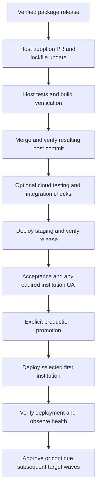

# CI/CD and fleet deployment design

Status: proposed design, 2026-10-29. This document defines a target architecture;
it does not enable workflows, provision environments, or authorize deployments.

## 1. Objective and decisions

Provide a visible, evidence-based path from a tested package change to a verified
deployment across independently managed bank and EMI hosts. Keep the workflow
manageable for a single developer while allowing different institutions to
accept and deploy releases on different schedules.

The initial platform is GitHub Actions, GitHub Environments and deployment
history, and Laravel Cloud. A later observational registry supplies a consolidated
fleet view across repositories. No additional CI/CD service is required initially.

Key decisions:

- Test packages before release and test hosts before deployment. These are
  separate gates with different evidence.
- Promote an explicitly identified host revision and dependency lockfile.
- Automatically deploy nonproduction stages after their prerequisites pass.
- Require an explicit production promotion decision and select its targets.
- Deploy production in controlled waves, with verification between waves.
- Keep institution production deployments and data boundaries independent.
- Keep registry availability outside runtime application behavior and deterministic
  compatibility checks.
- Show deployment outcome, observed release, and current health separately.

This is continuous delivery with controlled production promotion. Continuous
deployment of every merge to every institution is not the target.

## 2. Current implementation and evidence limits

The baseline below comes from local repository inspection, not verification of
live GitHub settings, successful workflow runs, or Laravel Cloud configuration.

| Area | Observed baseline | Work still required |
| --- | --- | --- |
| x-change CI | PRs to main and main pushes run four PHP shards, additional PHP verification, and Vue tests | Confirm required status checks and branch protection in GitHub |
| PHP aggregate | Checks prerequisite job outcomes and test inventory/results | Maintain inventory validation as suites evolve |
| x-change tag verification | A version-tag push checks main ancestry and successful exact-commit main-push CI, including PHP and Vue jobs | Make successful verification a prerequisite for host adoption |
| Package release | Owner-controlled immutable release sequence documented in x-change | Preserve release authority; a pushed tag exists before its verification completes |
| Host adoption | Documented Composer update, build publication, host tests, and committed host snapshot | Inspect and implement each host's actual deployment workflow |
| x-deploy manifest | Instance identity, environment, region, Git revision, lock hash, and package references | Bind these to trusted build/deployment metadata and verify the observed revision |
| x-deploy preflight | Package name/version presence and configured class/method availability | Add deterministic compatibility contracts where needed |
| x-deploy commissioning | Reuses the current compatibility checker | Add explicit readiness evidence; current success does not prove assets, database, workers, or financial readiness |
| x-deploy telemetry | Optional synchronous HTTP transport with timeouts and exception containment | Durable asynchronous outbox, authentication, retries, sequencing, and registry ingestion |
| Fleet registry | Architectural documentation | Implement storage, ingestion, authorization, and observational UI |

The existing architecture and telemetry documents describe intended behavior.
In particular, asynchronous delivery is a target, not a property of the current
HTTP reporter. Do not wire that reporter into financial request paths.

## 3. Ownership and boundaries

| Component | Responsibility |
| --- | --- |
| Package repositories | Source, focused tests, package CI, immutable releases |
| Host repository | Committed dependency graph, institution configuration references, generated build inputs where required, integration tests, deployment wiring |
| GitHub Actions | Gate execution, promotion orchestration, evidence capture, deployment status reporting |
| GitHub Environments | Named targets, scoped secrets, deployment history, supported protection rules |
| Laravel Cloud | Application builds, infrastructure-backed deployment, platform deployment status and logs |
| x-deploy | Manifests, deterministic compatibility results, commissioning contracts, sanitized release evidence |
| x-provisioning | Infrastructure preparation and provisioning authority |
| x-change | Application and financial behavior; authoritative domain readiness checks |
| x-journal | Durable deployment audit evidence through a future/verified adapter |
| Registry and dashboard | Observed fleet state, freshness, drift, and links to authoritative evidence |

The dashboard must not become a money-routing service, a secrets store, or a
runtime configuration authority. The initial registry cannot deploy, approve,
rotate credentials, or change institution settings.

## 4. Environment topology

| Environment | Purpose | Lifetime and isolation |
| --- | --- | --- |
| Local | Development and focused tests | Developer machine; no production credentials |
| CI testing | Automated package and host tests | Ephemeral runners and disposable service databases |
| Cloud testing, optional | Deployed integration tests and previews | Disposable or shared nonproduction target with synthetic data |
| Shared staging | Release rehearsal, browser acceptance, migrations, workers, callbacks, and sandbox providers | Persistent baseline; sized for representative behavior rather than production throughput |
| Institution UAT | Institution-specific acceptance and sandbox integrations | Create when onboarding, acceptance, or contract requirements justify it |
| Institution production | Real operations | Independently controlled deployment and resource boundary |

Testing is always a pipeline stage; it does not require a permanent cloud server.
If three hosted stages are useful, add cloud testing before staging without
changing the promotion model. A solo developer can begin with CI testing, one
shared staging host, production per institution, and UAT on demand.

Use separate Cloud applications per institution as the default organizational
boundary, with UAT and production environments where needed. Confirm the actual
account, access, network, and resource isolation required for each institution;
an application or environment name alone does not establish isolation.

Production databases, secrets, queue access, cache access, and object storage
access must be isolated by institution. Nonproduction must not have production
provider credentials or permission to consume production queues. Use synthetic
or explicitly sanitized test data. Cloud environments may use smaller compute,
but staging must retain required worker and scheduler behavior during acceptance.

Keep a shared package codebase. Put institution differences in supported host
configuration and adapters instead of long-lived customer source forks. A shared
staging result does not prove every institution-specific integration: require UAT
or a suitable configuration test matrix for affected integrations.

## 5. Release identity and reproducibility

Distinguish a package release from a host release. A package tag identifies one
package revision; a host revision and its lockfiles identify the combination
actually deployed.

The proposed release evidence record includes:

- Package repository, immutable tag, commit, and successful verification run.
- Host repository and exact commit SHA.
- Composer lock hash and resolved package versions/references.
- Frontend lock hash and relevant generated asset/build fingerprints.
- Runtime/build configuration identifier and non-secret configuration revision.
- CI run ID, attempt, gate results, and artifact references.
- Target instance/environment and Cloud deployment ID.
- Promotion decision, actor, target set, timestamp, and acceptance evidence.

These are proposed evidence fields, not additions to the current
`x-deploy.manifest.v1` schema. Implement extensions through an explicitly
versioned contract and compatibility tests. Do not hash or publish raw secrets
as configuration evidence; use an opaque configuration revision.

Build with committed lockfiles using `composer install` and the applicable
frontend lockfile installer. Do not run dependency updates during deployment.
Local Composer overrides, path repositories, and mutable package branches must
not enter the release inputs.

Cloud can rebuild a revision separately for each environment. Therefore the
initial promise is identical pinned source/dependencies with recorded build
inputs, not byte-identical images. If immutable artifact promotion is later
required, validate platform support and design that workflow explicitly.

For different institution host repositories, each host needs its own tested
revision even when all consume the same package release. Never infer that a
package version proves two hosts are identical.

## 6. Package release pipeline

1. Open a package PR and run the required PHP and Vue checks.
2. Merge only after the required checks and owner review requirements pass.
3. Verify CI for the resulting main commit.
4. Create a new immutable package tag under the existing release authority.
5. Wait for successful tag verification against that exact commit's main CI.
6. Permit host adoption only after that evidence exists.

The current tag workflow is retrospective verification: a failing workflow does
not remove the tag or prevent Composer from resolving it. The host adoption
gate must explicitly verify success. Never move a tag to repair a release.

Package CI remains in the owning package. Host pipeline summaries link to the
package evidence; separate repositories do not automatically appear as one
GitHub Actions graph.

## 7. Host adoption and promotion pipeline

Without cloud testing, connect merged-host verification directly to staging.
Promotion jobs depend on verified prior stages, not just completion of a job
that submitted a deployment request.

### Host verification

- Confirm the adopted package releases have successful release evidence.
- Install the committed dependency graph and produce the manifest.
- Run host integration tests and deterministic compatibility preflight.
- Publish package-owned build inputs using the supported publication command.
- Verify asset consistency and the production frontend build.
- Exercise migrations on disposable data using the production database engine
  where feasible; SQLite package tests alone do not prove PostgreSQL behavior.
- Test representative application, queue, and callback flows with fakes or
  sandbox services; automatic acceptance must not move real money.
- Reverify the merged host commit before using it as a deployment candidate.

### Staging and UAT

Deploy the selected host revision, record the platform deployment ID, wait for
completion, verify the observed release, and run safe smoke checks. Record manual
browser acceptance against that release when required. UAT acceptance must name
the institution configuration revision and tested release.

For hosts with different configurations, staging verifies common behavior and
institution-specific checks verify the differences. An acceptance decision is
invalidated when relevant code, dependencies, or configuration change.

### Production promotion

Choose the verified release, explicit targets, deployment window, and rollout
order. Show the currently observed version and proposed version before approval.
Recheck that evidence still matches the requested revision and configuration.

GitHub environment required reviewers can represent approval where available.
Availability depends on repository visibility and GitHub plan. For a solo operator,
preventing self-review requires another reviewer and can make the workflow
unusable. If native approval is unavailable, use a manually dispatched promotion
workflow with strict evidence validation and an audit record. This is an explicit
operator decision, not independent separation of duties. Institution requirements
may require another approver or a different plan.

Deploy to a selected eligible first institution, observe agreed health signals,
then continue to subsequent waves. Do not automatically select an institution
as an experimental target. Define observation duration and stop thresholds for
each rollout policy; a mere delay is not a health check.

## 8. Laravel Cloud integration and truthful pipeline status

For environments controlled by Actions, disable independent push-to-deploy so
Cloud cannot race ahead of the gates. Trigger the exact tested commit through
the supported deploy hook or API. A hook's commit must belong to the environment's
configured branch. If a separate promotion branch is used, preserve and verify
the intended commit; do not create an untested merge as part of promotion.

Each deployment job must:

1. Validate target authorization and release evidence.
2. Acquire deployment concurrency for that target.
3. Record the previous verified release and migration/recovery plan.
4. Trigger deployment and capture/correlate the specific Cloud deployment ID.
5. Wait for that deployment's terminal platform status with bounded polling.
6. Verify the running host reports the intended commit and lock fingerprint.
7. Execute readiness checks appropriate to the stage.
8. Record the outcome and update GitHub deployment status.

Implementation must first verify which Cloud API/CLI operations expose deployment
IDs and terminal statuses. A successful hook HTTP response is only request
acceptance. If correlation or status monitoring is unavailable, report requested
or unknown and require reconciliation; never invent successful completion.

An observed-release endpoint or authenticated remote command is proposed. It
must return sanitized metadata, identify the instance, and avoid stale cache
responses. Check all relevant application components through supported platform
evidence; one HTTP response alone does not prove every worker has updated.

Use separate steps for deterministic compatibility, infrastructure readiness,
and application commissioning. Place pre-activation checks in platform-supported
build/deploy phases. Checks that require live traffic occur after activation and
must have a recovery policy. Do not claim post-activation checks prevented
activation.

Serialize deployments per instance across all workflows. Do not cancel an active
production deployment when a newer candidate arrives. Cancellation of an Actions
run may not cancel a Cloud deployment: reconcile the platform state before retrying.
Retries must distinguish safe status reads from a new deployment request.

## 9. Visual pipeline and environment history

GitHub Actions is the first pipeline UI. Name jobs for operator decisions:
`Host tests`, `Deploy staging`, `Verify staging`, `Production promotion`,
`Deploy bank-a`, and `Verify bank-a`. Use job dependencies to render the actual
gate order. A manually dispatched production run links to its staging evidence
even if it is a separate graph.

Declare GitHub Environments such as `testing`, `staging`, `bank-a-production`,
and `emi-c-production` in the repository that owns their deployment workflow.
Configure environment URLs and scoped credentials. GitHub deployment records
must be created/updated by the integrated workflow; independent Cloud activity
does not automatically become complete GitHub history.

Every run summary should show:

- Candidate host revision and package/lock fingerprint.
- Environment and selected institution targets.
- Each gate's result and evidence links.
- Deployment ID, requested time, completion time, and verification time.
- Previous and observed releases.
- Approval or dispatch actor and acceptance reference.
- Failure category and next safe action, with sanitized log links.

Link to Cloud logs for platform failures and to host checks for application
failures. Do not put deploy hook URLs or credentials in summaries or artifacts.

## 10. Observational fleet dashboard

Add the registry UI when cross-repository visibility becomes cumbersome. Its
primary question is: which release is actually observed on each institution,
and how reliable and recent is that observation?

Proposed views:

| View | Content |
| --- | --- |
| Fleet overview | Institution, instance, environment, desired release, observed release, deployment outcome, health, heartbeat age |
| Release detail | Package graph, host revision, gate evidence, eligible targets, rollout progress |
| Instance detail | Timeline, current/previous release, compatibility and commissioning results, Cloud and GitHub links |
| Attention queue | Failed deployments, unknown outcomes, stale observations, unexpected revision/configuration drift |

Track independent dimensions rather than one overloaded green/red status:

- Pipeline: queued, running, waiting, passed, failed, cancelled, skipped.
- Deployment: requested, building/deploying, platform succeeded, verifying,
  verified, failed, unknown.
- Runtime health: healthy, degraded, unhealthy, unknown.
- Observation freshness: fresh or stale, based on a defined heartbeat policy.
- Release relationship: expected, approved older release, or unexpected drift.

An institution intentionally staying on an older approved release is not
automatically unhealthy. An old successful deployment with a stale heartbeat
must not appear currently healthy. Registry outages produce unknown/stale
observations, not fabricated host failures.

The first dashboard is read-only. Deployment controls, if ever added, require a
separate authorization design and must delegate to the established pipeline.

## 11. Evidence delivery and reconciliation

Proposed event categories include release observed, deployment requested,
deployment completed/failed, compatibility evaluated, commissioning evaluated,
and heartbeat. Define a versioned schema before implementation.

Use message ID, instance ID, deployment correlation ID, event time, receive time,
and a defined producer sequence/epoch to handle duplicate and out-of-order events.
The current event object has no sequence field; ordering is planned work. Do not
allow a delayed old heartbeat to overwrite a newer verified deployment.

Hosts write sanitized events to a durable local outbox; a background worker sends
them using bounded timeouts, backoff with jitter, retry limits, and a circuit
breaker. Set retention and storage limits with visible overflow/error reporting.
The registry deduplicates message IDs. Registry delivery failure must not fail
application requests or cause unbounded queue/storage growth.

Authenticate producers, restrict each credential to its instance or allowed
scope, encrypt transport, and support credential rotation. Prevent one host from
claiming another institution's identity. Apply authorization to read access as
well: institution users must not see other institutions' inventory or evidence.

Reconcile GitHub deployment records, Cloud deployment outcomes, and host release
observations. Preserve conflicting evidence for investigation; do not overwrite
it with the newest received payload. Manual emergency deployments must eventually
appear as external changes with an audit reference.

The registry is not the only evidence store. Preserve release records with CI
and, where integrated, x-journal. Define long-term retention independently of
short-lived CI artifacts. New promotion can block when required release evidence
cannot be established; a registry outage alone must not invalidate otherwise
available trusted evidence or stop running applications.

## 12. Failure handling and recovery

| Failure | Required behavior |
| --- | --- |
| Package or host tests fail | Block downstream release/adoption/promotion |
| Compatibility fails | Block controlled activation; fix the package graph or contract |
| Staging/UAT acceptance fails | Block production promotion for the affected release/targets |
| Cloud rejects or fails deployment | Record failure and reconcile the actual running revision |
| Status wait times out | Mark unknown, stop subsequent waves, inspect the correlated deployment |
| Observed revision differs | Fail verification, stop rollout, investigate target or build mismatch |
| Post-deployment health fails | Stop rollout and invoke the approved recovery procedure |
| Registry delivery fails | Retain bounded local evidence and retry asynchronously; application traffic continues |
| One institution fails | Stop the current rollout policy's next wave; preserve independent statuses for all targets |

Prefer backward-compatible expand/contract migrations so old and new application
versions can coexist during deployment. Separate destructive schema cleanup from
the release that introduces replacements. Record backup/restore readiness and
exercise recovery in nonproduction.

Application rollback does not reverse database migrations or completed financial
operations. Never automatically undo money movement, reset databases, or run live
provider scenarios as a deployment smoke test. Depending on schema compatibility,
recovery may require a forward fix rather than redeploying old code.

## 13. Security and operational controls

- Scope GitHub workflow permissions and Cloud credentials to the minimum required.
- Keep environment secrets separate; untrusted PR jobs must not receive deployment
  credentials. Prefer short-lived identity where supported and verified.
- Keep manifests, events, logs, and artifacts free of payer identities, provider
  payloads, credentials, and private financial evidence.
- Audit approval, dispatch, deployment, recovery, and configuration-change actors.
- Preserve owner-controlled merge and release authority unless explicitly delegated.
- Establish institution requirements for hosting location, access, acceptance,
  recovery objectives, and release windows before production onboarding. This
  architecture alone does not establish regulatory or contractual compliance.

## 14. Implementation phases

### Phase 0: verify existing controls

Inspect actual host workflows, branch protection, Cloud branch mapping and
push-to-deploy settings, available deployment-status APIs, and GitHub plan features.
Inventory production/UAT targets and identify who can approve each one. Do not
assume local workflow files prove hosted enforcement.

### Phase 1: visible delivery for one host

Implement host tests and staging deployment with exact revision correlation,
bounded completion monitoring, observed-release verification, GitHub environment
history, and linked run summaries. Add explicit production promotion for one
authorized target. Retain current package CI and release verification.

### Phase 2: multiple institution targets

Add per-target environment secrets, concurrency, UAT requirements, configuration
test coverage, and controlled waves. Persist desired versus observed releases and
link each host's adoption to the common package release.

### Phase 3: asynchronous evidence and fleet UI

Implement versioned event contracts, outbox delivery, authenticated ingestion,
deduplication, ordering, retention, and a read-only dashboard. Add x-journal
integration with verified behavior and keep runtime independent of the registry.

### Phase 4: operational hardening

Exercise recovery, partial rollout failure, cancelled-run reconciliation,
credential rotation, stale telemetry, and configuration drift. Establish alerts
and documented operator actions based on those exercises.

## 15. Acceptance criteria and verification plan

Implementation is ready when automated tests and nonproduction exercises prove:

1. Failed package verification prevents host adoption despite an existing tag.
2. Failed host checks prevent deployment; successful PR checks cannot substitute
   for evidence on a different merged revision.
3. Staging and production use the selected host revision and dependency graph.
4. A successful deploy-hook response alone cannot report deployment success.
5. Wrong revisions, unknown platform outcomes, and failed readiness checks stop
   promotion and retain diagnostic evidence.
6. Concurrent requests cannot deploy two releases to the same instance at once.
7. Cancellation/retry does not silently create overlapping production deployments.
8. Approval binds to the exact release, configuration revision, and selected targets.
9. One institution's failure does not mislabel other institutions' states.
10. Registry failure leaves runtime behavior unaffected and bounds retry/storage cost.
11. Duplicate, delayed, and forged events cannot corrupt another instance's state.
12. Dashboard freshness and runtime health remain distinct from historical success.
13. Logs and artifacts exclude secrets and private financial data.
14. Recovery is rehearsed without resetting production data or invoking live transfers.

Every package behavior change requires Pest coverage; workflow tooling also needs
focused tests for gate/evidence validation. Use nonproduction deployment exercises
for platform behavior that unit tests cannot prove. This documentation-only design
does not claim that these acceptance criteria have already passed.

## 16. Open implementation decisions

- Which host repository is the first end-to-end pilot?
- Does a permanent cloud testing target provide value beyond ephemeral CI?
- Which institutions require dedicated UAT and independent approval?
- Can current Cloud interfaces correlate and monitor a deployment reliably, and
  how will workers and schedulers expose their active release?
- Which GitHub plan and environment protections are available for private hosts?
- What are rollout observation periods, stop thresholds, recovery objectives,
  heartbeat freshness limits, and evidence retention periods?
- Where will the observational registry and UI live, and who may access them?

Resolve these during implementation without changing the core boundaries above.

## References

Local package documentation:

- [Architecture](architecture.md)
- [Manifest](manifest.md)
- [Commissioning](commissioning.md)
- [Telemetry](telemetry.md)
- [Registry](registry.md)
- [x-journal integration](x-journal-integration.md)

Related x-change sources, when the sibling checkout is available:

- [Package CI](../../x-change/.github/workflows/ci.yml)
- [Tag verification](../../x-change/.github/workflows/release-verification.yml)
- [Package onboarding and release authority](../../x-change/docs/deployment/AI_AGENT_PACKAGE_ONBOARDING.md)
- [Package development workflow](../../x-change/docs/deployment/PACKAGE_DEVELOPMENT_WORKFLOW.md)

Platform documentation consulted for the design (recheck before implementation):

- [GitHub deployment orchestration and visual monitoring](https://docs.github.com/en/actions/how-tos/deploy/configure-and-manage-deployments/control-deployments)
- [GitHub deployment history](https://docs.github.com/en/actions/how-tos/deploy/configure-and-manage-deployments/view-deployment-history)
- [GitHub environment protection and plan limitations](https://docs.github.com/en/actions/reference/workflows-and-actions/deployments-and-environments)
- [Laravel Cloud deployments and commit-specific hooks](https://laravel.com/cloud/docs/deployments)
- [Laravel Cloud environments](https://laravel.com/cloud/docs/environments)
